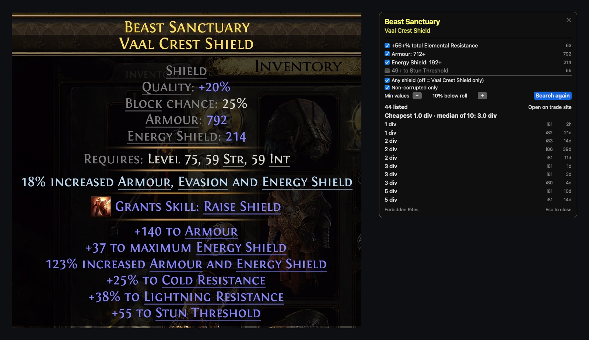
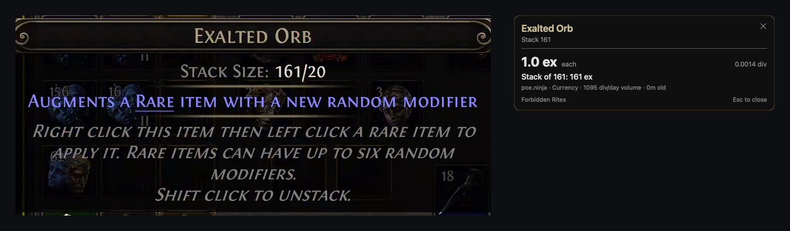
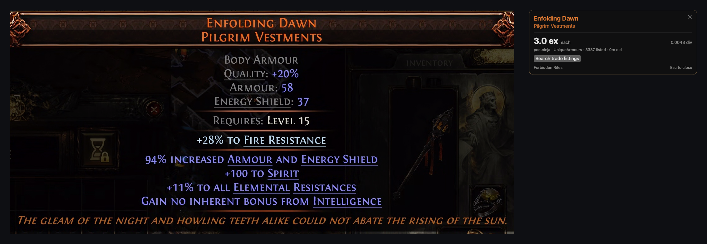

# PoEPriceCheck

A macOS menu-bar price checker for **Path of Exile 2** that works while you play through **GeForce NOW**.

Overlays like Awakened PoE Trade and Exiled Exchange 2 read the item text from the clipboard. Under
GeForce NOW the game runs on NVIDIA's cloud PC, so that clipboard never reaches your Mac. PoEPriceCheck
reads the **tooltip off your screen** with Apple's Vision OCR instead. Hover an item, press **⌃D**, and a
small panel shows the price next to the cursor.



| Currency stack (poe.ninja) | Unique (poe.ninja) |
|---|---|
|  |  |

## What it does

- **Currency, fragments, runes, essences, omens, ritual items, uniques:** priced from
  [poe.ninja](https://poe.ninja/poe2) (cached for 15 minutes), with the stack total.
- **Rares and magic items:** priced with a **fuzzy** search on the official trade site, because searching
  every exact stat usually finds nothing. The search:
  - uses only the stats that drive value (skill levels, movement speed, spirit, life, resistances,
    crit, cast/attack speed, DPS, defences…) and skips filler mods
  - folds related mods into pseudo totals: total life, total elemental resistance, attributes
  - searches **minimums only**, a margin below each roll (default 10%), with no maximums
  - replaces local defence and damage mods with the item's Armour/Evasion/ES or DPS
  - **relaxes automatically** below 10 results (drops the item-level floor, widens the margin, then
    drops the least important stat) and shows what it changed
  - lets you tick/untick stats and change the margin in the panel, then **Search again**, or
    **Open on trade site**
- **Unidentified items:** priced by base type and unidentified tier.
- **League:** read from the in-game area overlay when it's on screen (e.g. "Forbidden Rites League");
  otherwise poe.ninja's current league, or pick one from the menu.
- Respects GGG's `X-Rate-Limit-*` headers.

It is **read-only**: it captures the screen and calls public price APIs. It never sends keystrokes or
clicks to the game.

## How it works

1. A listen-only keyboard tap (plus a regular global hotkey) sees ⌃D even when GeForce NOW or Chrome has
   grabbed the keyboard in fullscreen.
2. ScreenCaptureKit grabs the display. Vision OCRs it in about 0.2 s on Apple Silicon.
3. The tooltip is found as the stack of **centre-aligned** text lines on a **near-black panel**. Stash
   tab labels, the right-aligned map overlay and world text are rejected. Text colour, normalised for
   brightness so dimmed tooltips still work, gives the rarity and mod types.
4. Lines are matched to trade stat IDs with fuzzy matching against the trade site's stat templates, which
   tolerates OCR typos.
5. If a frame looks smeared by video compression, it re-captures once.

## Install

Requirements: macOS 14+ on Apple Silicon (built and tested on an M4 at 3840×2160), Xcode 15+ / Swift 5.10+.

```bash
git clone https://github.com/FuzzySideUp/PoEPriceCheck.git
```

```bash
cd PoEPriceCheck && scripts/build_app.sh
```

```bash
open ~/Applications/PoEPriceCheck.app
```

The build script signs with your Apple Development certificate if you have one. That keeps the
permissions below across rebuilds; with ad-hoc signing macOS may ask again after each rebuild.

Grant two permissions when prompted (System Settings › Privacy & Security), then quit and reopen the app:

- **Screen & System Audio Recording:** to read the tooltip
- **Input Monitoring:** so ⌃D works while GeForce NOW holds the keyboard in fullscreen

The dollar-sign menu-bar icon has the hotkey, league, default margin, listing status, panel size, and
"Save captures" for debugging.

## Development

```bash
swift test --scratch-path ~/Library/Caches/PoEPriceCheck/build
```

- `Fixtures/screens/` holds real GeForce NOW tooltip captures (cropped) with expected parses. The
  fixture test runs every one through OCR, tooltip detection and parsing.
- `POE_LIVE=1 swift test … --filter LiveTests` hits poe.ninja and the trade API.
- `swift run --scratch-path ~/Library/Caches/PoEPriceCheck/build ocrtool <image> [cursorX cursorY] [--all] [--price]`
  shows what the OCR sees, the parsed item, the fuzzy search, and optionally live prices.
- With **Save captures** on, each check writes a PNG and OCR JSON to
  `~/Library/Application Support/PoEPriceCheck/captures`. A step-by-step log is in `log.txt` next to it.
- `scripts/build_app.sh --refresh-data` re-downloads trade stats and base types after a patch.
- If the project lives in an iCloud-synced folder, keep builds outside it (as above): Finder metadata
  on build products breaks code signing.

## Status

Early and PoE 2 only. Tested on one 4K display at 1× scaling. Other resolutions should work, but the
detection thresholds were tuned on 4K captures. PoE 1 support (poe.ninja + `api/trade`) is a natural next
step.

## Disclaimer

Unofficial fan project, not affiliated with or endorsed by Grinding Gear Games or NVIDIA. Price data
comes from [poe.ninja](https://poe.ninja) and the
[official trade site](https://www.pathofexile.com/trade2). Base-type data comes from
[RePoE](https://github.com/repoe-fork/repoe-fork). Use the trade API considerately.
